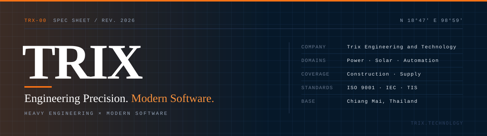

<p align="center">
  
</p>

<h3 align="center">Heavy engineering, delivered with modern software.</h3>

<p align="center">
  <a href="https://trix.technology">trix.technology</a>
  &nbsp;·&nbsp;
  <a href="https://trix.technology/services">Services</a>
  &nbsp;·&nbsp;
  <a href="https://trix.technology/projects">Projects</a>
  &nbsp;·&nbsp;
  <a href="https://trix.technology/contact">Contact</a>
</p>

---

**Trix Engineering and Technology Co., Ltd.** is a full-service engineering company based in Chiang Mai, Thailand. Every system we build is engineered on paper, tested on site and delivered with a monitoring layer, so our clients see real data and can verify what they paid for.

## Service lines

| Code | Service line | Scope |
|---|---|---|
| `TRX-01` | **Electrical & Power** | HV systems 22 / 33 / 115 kV, transformers, switchgear and RMU, lightning protection and earthing, MDB / DB panels, inspection and certification |
| `TRX-02` | **Solar & Renewable** | Rooftop, carport and solar farm EPC, hybrid and battery storage, PV layout and yield design, PPA and utility interconnection, monitoring and annual O&M |
| `TRX-03` | **Automation & Software** | PLC, SCADA and HMI, IoT gateways and edge computing, real-time monitoring dashboards, data analytics and reporting, building management systems |
| `TRX-04` | **Construction & Civil** | Commercial, industrial and residential buildings, factories and warehouses, roads and bridges, interior, exterior and landscape works, renovation |
| `TRX-05` | **Trading & Supply** | Construction materials, HV and LV electrical equipment, solar equipment, fire alarm, CCTV and access control, technical machinery |

## Engineering software

| Product | What it does |
|---|---|
| **TRIX Monitoring** | Time-series platform for solar, power and IoT assets: live dashboards, alerts, customer portal, signed over-the-air updates |
| **[TRIX Deye Gateway](https://github.com/trix-eng-technology/deye-gateway-firmware)** | ESP32-S3 gateway that reads Deye hybrid inverters over RS485 and reports to TRIX over MQTT with TLS |

## How we work

```
FEASIBILITY  ->  DESIGN  ->  EPC  ->  COMMISSIONING  ->  O&M
     every stage documented, tested and monitored
```

- **Verifiable engineering** - calculations behind every design, test reports for every installation.
- **Software at the core** - every system ships with monitoring, not as an afterthought.
- **Stage-gate delivery** - weekly progress reviews to keep schedule and budget on track.

---

<p align="center">
  <sub>Trix Engineering and Technology Co., Ltd. · Chiang Mai, Thailand · N 18°47′ E 98°59′</sub>
</p>
